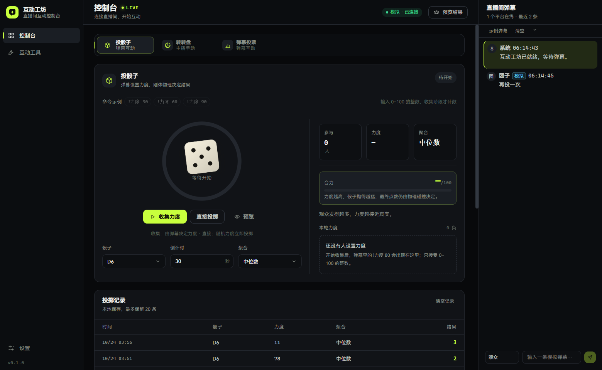
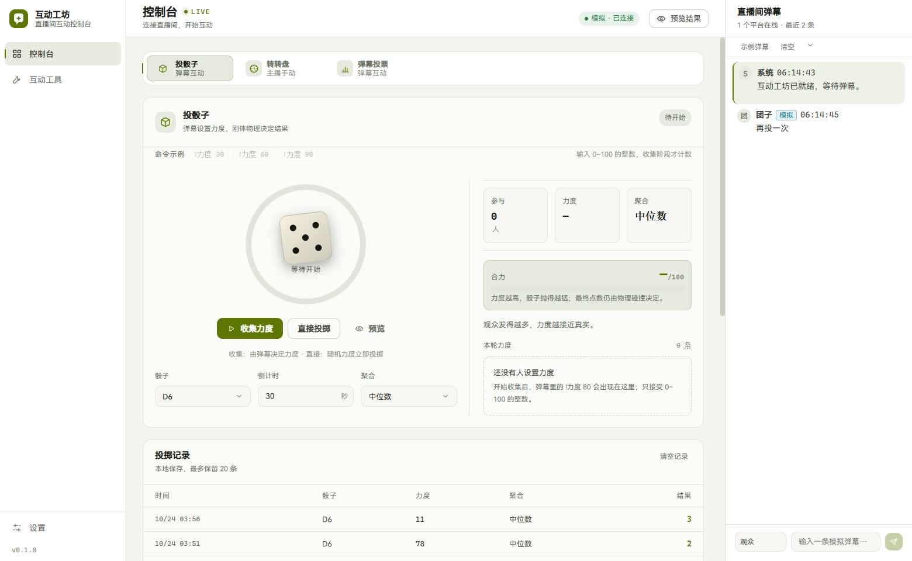
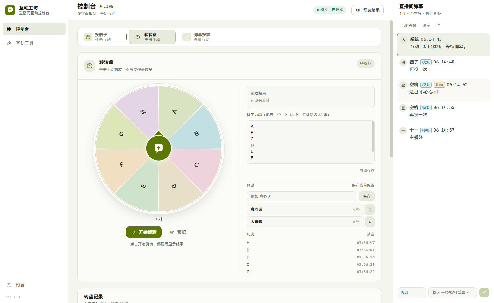
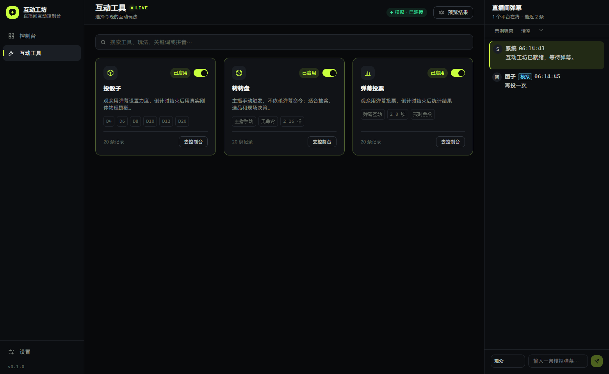
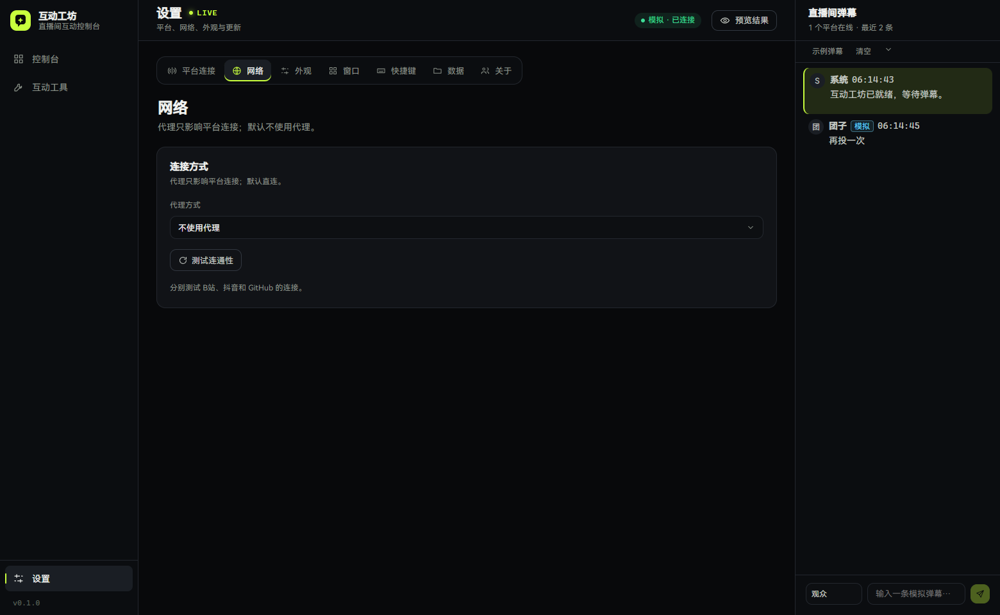

<div align="center">

# 互动工坊

**把直播间弹幕，变成可以玩的现场节目。**

本地优先的直播互动控制台：多平台只读接入，弹幕、礼物与进场实时汇聚，互动玩法以工具插件扩展。

[](https://github.com/cambridgejames/InteractTools/actions/workflows/verify.yml)
[](https://www.electronjs.org/)
[](https://vuejs.org/)
[](https://www.typescriptlang.org/)
[](https://github.com/cambridgejames/InteractTools/releases/latest)
[](LICENSE)

[English overview](README.en.md) · [快速开始](#快速开始) · [文档](#文档)

</div>

---

## 为什么是互动工坊

直播互动工具经常散落在浏览器插件、脚本和一堆手动操作里：弹幕看不清、结果不可信、直播中断了还在弹窗。

互动工坊把这些问题收进一个桌面应用：

- **玩法是插件**：投骰子、转转盘、弹幕投票共用平台、历史、面板动画与结果弹窗，新增工具不用重做基础设施。
- **结果可解释**：骰子由真实刚体物理决定；转盘先随机结果，再随机落点；投票只统计有效票。
- **只读接入**：B站、抖音只读取弹幕、礼物和进场，不登录、不发消息、不刷量。
- **直播时不添乱**：结果弹窗手动关闭，弹幕区可折叠 / 隐藏，OBS 直接采集控制台窗口。

## 下载

当前 MVP：[互动工坊 v0.1.0](https://github.com/cambridgejames/InteractTools/releases/tag/v0.1.0)

| 平台 | 产物 |
| --- | --- |
| Windows x64 / arm64 | NSIS 安装包、portable、zip |
| macOS x64 / arm64 | dmg、zip |
| Linux x64 | AppImage、deb |

Windows 与 macOS 的安装包支持检查更新；zip 解压版会下载新 zip，退出后替换并重启。

## 目录

- [下载](#下载)
- [界面](#界面)
- [功能](#功能)
- [工作流程](#工作流程)
- [快速开始](#快速开始)
- [技术栈](#技术栈)
- [架构](#架构)
- [文档](#文档)
- [项目状态](#项目状态)
- [贡献](#贡献)

## 界面

| 控制台（深色） | 控制台（浅色） |
| --- | --- |
|  |  |
| **转转盘** | **互动工具** |
|  |  |

| 网络与连通性 |
| --- |
|  |

## 功能

### 投骰子

观众发送 `!力度 80` 设置力度，同一观众只取最后一条。倒计时结束后按中位数聚合（可切换均值 / 截尾均值），用 cannon-es 做真实刚体模拟：力度决定上冲速度、自旋与二次弹跳，d6 使用圆角倒角，镜头随高度推拉。

### 转转盘

主播手动触发，不需要弹幕命令。选项直接写在扇形上并跟着转；每次独立随机中奖格，再在格内随机一个避开正中的落点，最后随机使用滑步或急停收尾。不积累历史，不偷偷“平衡”概率。

### 弹幕投票

观众发送 `!投票 1` 或选项文字。默认同一观众只计第一票，可开启「允许改票」；倒计时结束统计并列最高票并弹出结果。

### 弹幕与平台

- B站匿名只读：WBI 签名 + WSS 认证，支持直播中 / 轮播 / 未开播状态。
- 抖音只读：直播间号或链接，本地匿名签名连接，采集弹幕、礼物、进场。
- 本地模拟：离线演示完整链路，模拟观众会按当前工具发送命令。
- 实时弹幕栏：虚拟滚动、贴底阅读、未读提示、进场 ticker；聊天与礼物保留最近 1000 条。
- 消息标签只显示「模拟」「礼物」等必要信息，不显示平台来源。

### 控制台与设置

- 顶部工具切换器按 manifest 自动出现；「互动工具」页可单独开关工具、搜索、拼音与首字母匹配。
- 深色 / 浅色 / 跟随系统主题，原生标题栏同步。
- 网络代理：直连 / 系统 / 自定义 HTTP(S)，支持认证、直连域名与自签名 TLS。
- 日志按天 + 20MB 滚动，保留 20 个历史文件，设置页可收集日志包。
- 内置检查更新：安装版走 electron-updater，zip 解压版下载 zip 后退出替换并重启。
- 教程、快捷键、窗口位置、多显示器恢复、预设与历史均可在设置页管理。

## 工作流程

```text
连接平台  →  弹幕进入控制台  →  工具收集 / 主播触发  →  结果弹窗  →  OBS 采集
```

工具关闭后不再接收命令，重新打开会恢复配置与历史；直播连接不受工具开关影响。

## 快速开始

### 环境要求

| 要求 | 版本 |
| --- | --- |
| Node.js | `>= 22.12` |
| npm | 随 Node 安装 |
| 操作系统 | Windows / macOS / Linux |

### 开发

```bash
git clone https://github.com/cambridgejames/InteractTools.git
cd interact-tools
npm install
npm run dev
```

默认连接「本地模拟」。打开控制台 → 开始收集 → 在右侧发送 `!力度 80`，即可跑通一轮投骰子。

### 构建与打包

```bash
npm run typecheck    # 类型检查
npm run lint         # ESLint + 依赖边界 + 设计 token + 文档
npm run test         # Vitest
npm run build        # 构建三进程产物
npm run smoke        # 启动 Electron 并截图到 artifacts/smoke

npm run package:win  # Windows x64 + arm64（NSIS / portable / zip）
npm run package:mac  # macOS x64 + arm64（dmg / zip）
npm run package:linux # Linux x64（AppImage / deb）
```

## 技术栈

| 层 | 选型 | 用途 |
| --- | --- | --- |
| 桌面壳 | Electron 44 + electron-vite 6 | 窗口、IPC、构建 |
| 界面 | Vue 3.5 + TypeScript 5.9 | 控制台与结果弹窗 |
| 3D / 物理 | Three.js + cannon-es | 骰子舞台与真实刚体 |
| 校验 | zod 4 | 配置、IPC、平台报文边界 |
| 平台 | ws + protobufjs + vm | B站 / 抖音只读连接 |
| 日志 | winston + daily rotate | 按天 / 大小滚动与收集 |
| 测试 | Vitest | 契约、工具、平台解析与 UI |
| 打包 | electron-builder | 三平台产物与自动更新元数据 |

## 架构

```text
contracts  ←  kernel  ←  platforms / tools  ←  main  ←  preload  ←  renderer
```

- `contracts`：跨进程类型与 zod schema，不依赖任何业务实现。
- `kernel`：平台无关 Engine、CommandBus、ToolHost，不 import Electron / ws / Three.js。
- `platforms`：B站、抖音、本地模拟适配器；只读，不发送用户内容。
- `tools`：dice / wheel / vote，各自维护状态机、配置与历史。
- `main`：唯一组合根，负责窗口、存储、IPC 与生命周期。
- `renderer`：只通过 preload 暴露的窄接口访问主进程。

更完整的分层、依赖方向与数据流见 [docs/ARCHITECTURE.md](docs/ARCHITECTURE.md)。

## 目录

```text
src/
├── contracts/     公共契约（类型 + zod）
├── kernel/        平台无关内核
├── platforms/     B站 / 抖音 / 本地模拟
├── tools/         dice / wheel / vote
├── main/          Electron 组合根、窗口、存储、IPC
├── preload/       contextBridge 窄接口
└── renderer/      控制台、面板动画、结果弹窗
docs/
├── design/        视觉、主题、网络、日志、平台、更新
├── roadmap/       待验证与未实施方案
└── testing.md     测试策略
```

## 文档

| 文档 | 内容 |
| --- | --- |
| [docs/usage.md](docs/usage.md) | 使用说明与 OBS 配置 |
| [docs/ARCHITECTURE.md](docs/ARCHITECTURE.md) | 分层、进程、IPC 与数据流 |
| [docs/design/README.md](docs/design/README.md) | 已落地子系统设计 |
| [docs/roadmap/README.md](docs/roadmap/README.md) | 进度与未实施方案 |
| [docs/testing.md](docs/testing.md) | 测试策略 |
| [AGENTS.md](AGENTS.md) | 架构不变量与协作规范 |
| [CONTRIBUTING.md](CONTRIBUTING.md) | 贡献流程与自检 |
| [SECURITY.md](SECURITY.md) | 安全模型与漏洞报告 |
| [CHANGELOG.md](CHANGELOG.md) | 版本变更 |

## 项目状态

当前是**可运行原型**：控制台、本地模拟、B站匿名只读、抖音只读握手、投骰子、转转盘、弹幕投票、真实物理、结果弹窗、主题、代理、日志与自动更新均已落地。

已验证：

- B站 WBI 签名 + WSS 认证真连，直播 / 轮播 / 未开播状态可显示。
- 抖音本地匿名签名与 WSS 握手；弹幕内容仍需活跃房间实测记录。
- 本地模拟完整链路。

已实现、待实机验证：

- 三平台打包配置（Windows / macOS 为 x64 + arm64，Linux 为 x64）与 zip 解压更新流程。
- 安装包实机安装与自动更新。
- OBS 采集与长时间直播稳定性。
- 抖音真实弹幕内容解析。

## 贡献

欢迎 Issue 和 PR。开始前请阅读 [CONTRIBUTING.md](CONTRIBUTING.md) 与 [AGENTS.md](AGENTS.md)。

安全问题请遵循 [SECURITY.md](SECURITY.md) 私密报告，不要开公开 Issue。

## 许可证

[MIT](LICENSE) © CambridgeJames
